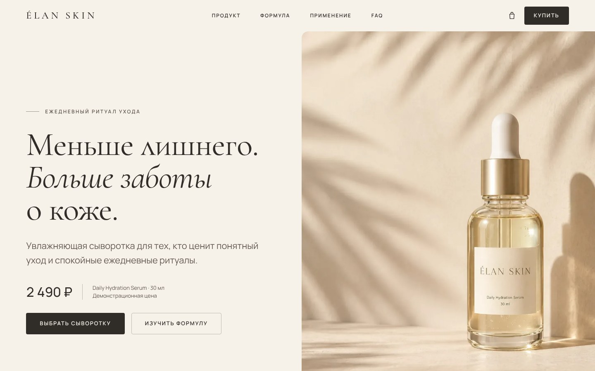
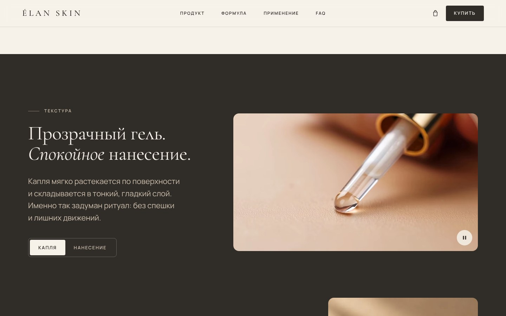
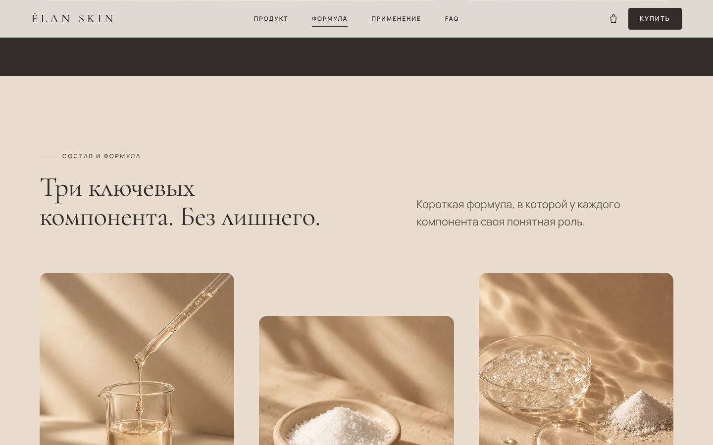
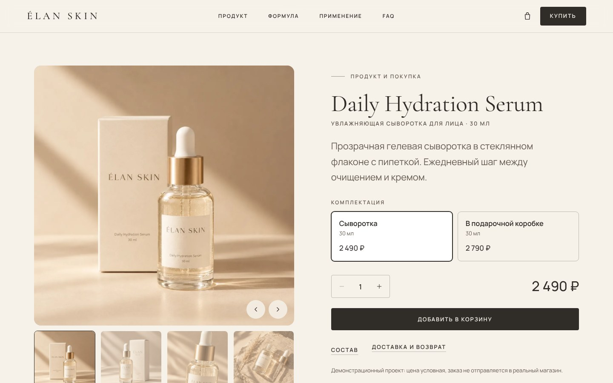
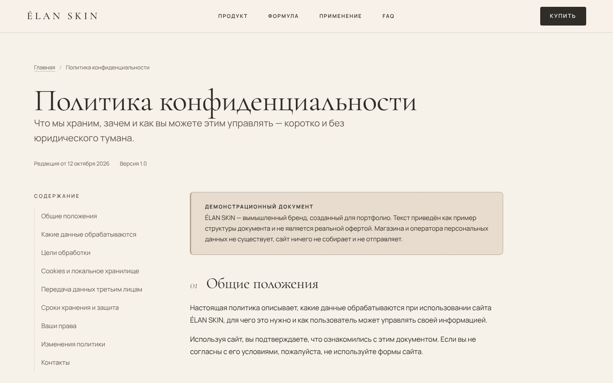
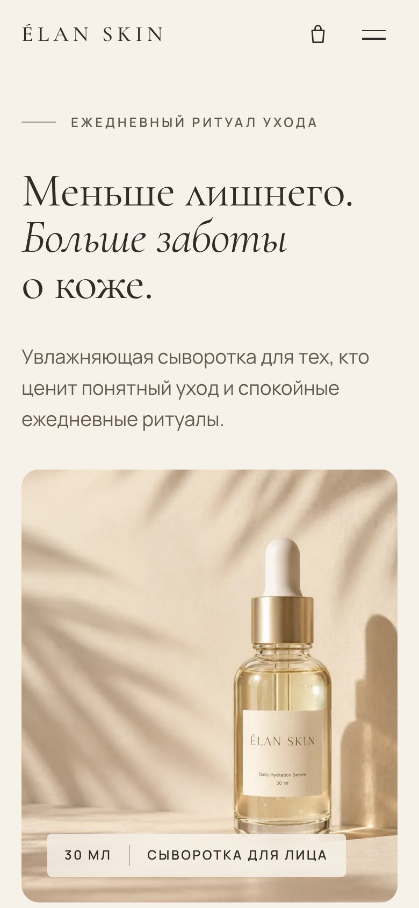
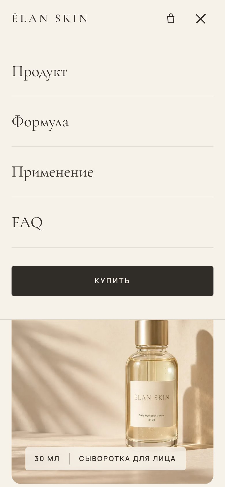
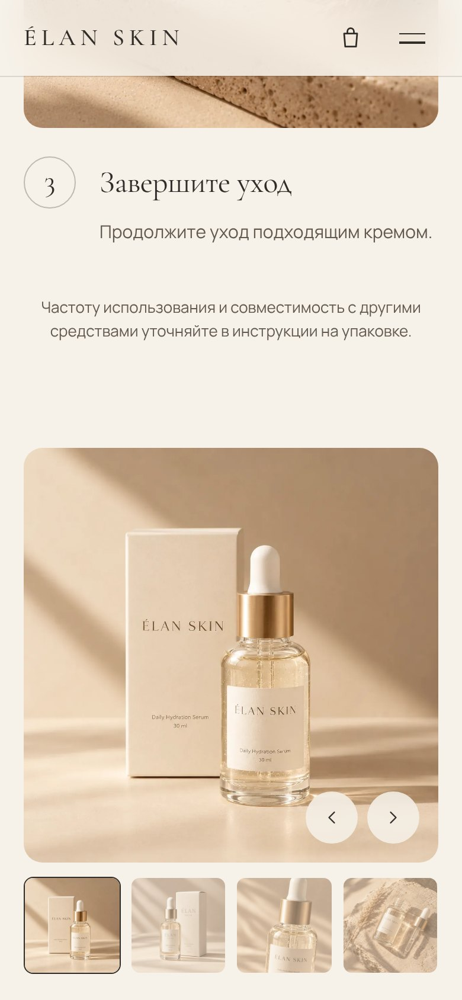

<div align="center">

# ÉLAN SKIN

**Концептуальный лендинг премиального бренда уходовой косметики**

Светлая editorial-эстетика · один флагманский продукт · рабочая демонстрационная корзина · адаптивная вёрстка


</div>



> **Это концепт.** Бренд ÉLAN SKIN, продукты, цены, состав, условия доставки и контакты вымышлены.
> Сайт создан как работа для портфолио: платёжного сервиса и backend нет, заказы никуда не отправляются.

## Содержание

- [О проекте](#о-проекте)
- [Возможности](#возможности)
- [Быстрый старт](#быстрый-старт)
- [Структура проекта](#структура-проекта)
- [Дизайн-система](#дизайн-система)
- [Демо-режим](#демо-режим)
- [Доступность и производительность](#доступность-и-производительность)
- [Публикация](#публикация)
- [Скриншоты](#скриншоты)
- [Лицензии](#лицензии)

## О проекте

В основе сайта — один флагманский продукт, увлажняющая сыворотка **Daily Hydration Serum**. Страница шаг за шагом ведёт посетителя
по сценарию покупки: *увидеть продукт → понять преимущества → изучить состав → убедиться в удобстве применения → выбрать комплектацию → добавить в корзину*.

Проект не использует фреймворков: только семантический HTML, CSS на custom properties и JavaScript (ES-модули). Vite нужен для локальной разработки и production-сборки.

## Возможности

**12 секций лендинга**
шапка · Hero · знакомство с продуктом · преимущества · текстура (видео) · состав и формула · применение · покупка · дополнительное предложение · философия бренда · FAQ · финальный CTA и подвал.

**Интерактив**
- Плавная навигация, подсветка текущего раздела, мобильное меню (Esc, клик вне меню, автозакрытие).
- Демо-корзина: добавление, изменение количества, удаление, подсчёт суммы, сохранение в `localStorage`, мини-корзина, анимация добавления.
- Выбор комплектации с пересчётом цены и синхронной сменой фото в галерее.
- FAQ-аккордеон с управлением мышью, Enter/Space, стрелками, Home/End.
- Форма подписки с валидацией и честным уведомлением о демо-режиме.
- Видео-секция: переключение роликов, пауза, автозапуск только в зоне видимости.
- Анимации: появление при скролле, мягкий параллакс, наклон Hero-изображения. Полностью отключаются при `prefers-reduced-motion`.

**Страницы-документы**
[Политика конфиденциальности](privacy.html) · [Условия покупки](terms.html) · [Доставка и возврат](delivery.html) — в общем стиле, с содержанием и адаптивной таблицей.

## Быстрый старт

Требуется Node.js 18 или новее.

```bash
git clone https://github.com/<your-username>/elan-skin.git
cd elan-skin
npm install

npm run dev       # сервер разработки с горячей перезагрузкой
npm run build     # production-сборка в папку dist/
npm run preview   # локальный просмотр собранной версии
```

## Структура проекта

```
elan-skin/
├── index.html                # лендинг
├── privacy.html              # политика конфиденциальности
├── terms.html                # условия покупки
├── delivery.html             # доставка и возврат
├── vite.config.js            # многостраничная сборка, base: "./"
├── public/                   # копируется в dist без изменений
│   ├── images/               # WebP в нескольких размерах + постеры видео
│   ├── video/                # WebM + MP4 без звука
│   ├── icons/                # PWA-иконки 192 / 512
│   ├── favicon.svg · favicon.ico · apple-touch-icon.png
│   ├── site.webmanifest · robots.txt · og.jpg
├── src/
│   ├── main.js               # точка входа лендинга
│   ├── legal.js              # точка входа страниц-документов
│   ├── fonts/                # Cormorant Garamond, Manrope (SIL OFL)
│   ├── styles/
│   │   ├── variables.css     # дизайн-токены
│   │   ├── base.css          # сброс, типографика, фокус, reveal
│   │   ├── layout.css        # сетка, шапка, макеты секций
│   │   ├── components.css    # кнопки, формы, корзина, галерея, FAQ
│   │   ├── responsive.css    # точки перелома
│   │   └── legal.css         # страницы-документы
│   └── scripts/
│       ├── navigation.js     # шапка и мобильное меню
│       ├── cart.js           # корзина и мини-корзина
│       ├── buy.js            # галерея, комплектации, количество
│       ├── faq.js            # аккордеон
│       ├── media.js          # видео-секция
│       ├── animations.js     # reveal, параллакс, tilt
│       └── ui.js             # toast, диалоги, форматирование, подписка
├── docs/screenshots/         # изображения для README
└── .github/workflows/        # публикация на GitHub Pages
```

## Дизайн-система

| Токен | Значение | Применение |
| --- | --- | --- |
| Warm Ivory | `#F6F1E9` | основной фон |
| Soft Sand | `#E7DCCE` | второстепенные блоки |
| Muted Taupe | `#B7A18A` | линии, акценты |
| Warm Nude | `#D9BFA5` | небольшие акценты |
| Deep Brown | `#302C28` | текст, кнопки, тёмные секции |
| Pure White | `#FFFFFF` | карточки, выбранные состояния |

**Шрифты:** Cormorant Garamond — заголовки, Manrope — текст, навигация, цены. Подключены локально (`src/fonts`), поддерживают кириллицу.

**Сетка:** контейнер до 1440 px, шаг отступов 8 px, радиусы 4–16 px. Точки перелома: 1440+, 1024–1439, 768–1023, 375–767, 320–374. Все значения живут в `src/styles/variables.css`.

## Демо-режим

- Корзина хранится только в браузере (`localStorage`, ключ `elan-skin:cart:v1`).
- Кнопка «Оформить заказ» сообщает, что заказ не отправляется.
- Форма подписки проверяет e-mail и **ничего не сохраняет и не отправляет**.
- Условия доставки и возврата, документы, контакты и цены — примеры.

Перед использованием как реального магазина необходимо заменить состав (INCI), заявления о свойствах продукта, цены, документы и контакты на фактические, подключить платёжный сервис и серверную часть.

## Доступность и производительность

- Семантическая разметка, корректная иерархия H1–H3, skip-link, `aria-*` для меню, аккордеона и корзины.
- Видимый фокус, полное управление с клавиатуры; контраст текста не ниже 4.5:1.
- Уважение `prefers-reduced-motion`: контент не зависит от анимации.
- WebP с `srcset`, заданные `width`/`height`, `loading="lazy"` ниже первого экрана, приоритетная загрузка Hero.
- Видео без звука, WebM + MP4, подгрузка по требованию.
- SEO: уникальные `title` и `description`, Open Graph, favicon, manifest.

## Публикация

Сборка использует относительные пути (`base: "./"`), поэтому подходит для любого хостинга.

**GitHub Pages.** В репозитории уже есть workflow `.github/workflows/deploy.yml`. Откройте *Settings → Pages → Source* и выберите **GitHub Actions**. После push в `main` сайт соберётся и опубликуется автоматически.

**Другой хостинг.** Выполните `npm run build` и загрузите содержимое папки `dist/`.

## Скриншоты

| | |
| --- | --- |
|  |  |
|  |  |
|  |  |

<p>
  
  
  
</p>

## Лицензии

- **Код** распространяется по лицензии [MIT](LICENSE).
- **Шрифты** Cormorant Garamond и Manrope — [SIL Open Font License 1.1](src/fonts) (тексты лицензий лежат рядом со шрифтами).
- **Фирменные материалы** (название и логотип ÉLAN SKIN, фотографии, видео, тексты) — часть концептуальной работы и не предназначены для повторного использования без согласия автора.
# elan-skin
